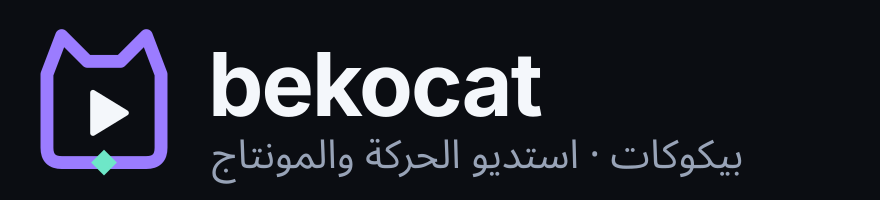

  

# بيكوكات Bekocat

تطبيق أندرويد عربي أولًا للمونتاج والموشن جرافيك، مجاني بالكامل: **بلا اشتراك، بلا علامة مائية، بلا إعلانات، بلا تسجيل دخول.** المعالجة على جهازك.

> ⚠️ **حالة المشروع:** هذا هو **الأساس الهندسي للإصدار 1.0** وليس الإصدار المكتمل. ما نُفّذ وما اختُبر وما لم يبدأ بعد موثّق بدقة في [`FEATURE_MATRIX.csv`](FEATURE_MATRIX.csv) و[`PROJECT_STATE.md`](PROJECT_STATE.md).

## ما يعمل في هذا البناء
- محرك خط زمني بزمن كسري دقيق (23.976 / 29.97 / 59.94 بلا انزياح)، مسارات فيديو/طبقات/نص/صوت.
- قص، تقطيع، حذف مع سد الفراغ (Ripple)، تكرار، سرعة ثابتة، Insert/Overwrite/Slip/Slide/Roll في المحرك.
- تراجع وإعادة لكل العمليات، وأمر المساعد يُطبَّق كتعديل واحد قابل للتراجع.
- معاينة فيديو، خط زمني بصور مصغّرة وتكبير بالقرص، تقدّم إطارًا بإطار.
- تصحيح لوني أساسي (إضاءة، تباين، تشبع، حرارة، صبغة) مطابق بين المعاينة والتصدير.
- طبقات نص عربية/إنجليزية في المعاينة (تشكيل واتجاه صحيحان عبر محرك نصوص أندرويد).
- أوامر مباشرة بالعربية: «لون سينمائي دافئ وانتقالات ناعمة»، «سرّع ٢»، «تقريب من ٢ إلى ٥».
- تصدير MP4 (H.264/AAC) بدقة 720p حتى 4K، عمودي/أفقي/مربع، مع التقدم والإلغاء وفحص الملف الناتج وحفظه في `Movies/Bekocat` ومشاركته.
- حفظ تلقائي ذري مع نسخة احتياطية واسترجاع، ومخطط مشروع بإصدارات وترحيل.

## الحصول على ملف APK عبر GitHub
1. أنشئ مستودعًا جديدًا على GitHub وارفع **محتويات** هذا المجلد كما هي (مع مجلدَي `.github` و`gradle`).
2. افتح تبويب **Actions**؛ سيبدأ سير العمل **Build Bekocat APK** تلقائيًا.
3. بعد انتهائه افتح التشغيل ← **Artifacts** ← نزّل `bekocat-debug-apk` ← فك الضغط ← ثبّت الملف على هاتفك (أندرويد 10 فأحدث).
4. لإنشاء إصدار: ادفع وسمًا مثل `v0.1.0` وسيُرفق الـ APK تلقائيًا في صفحة Releases.

التفاصيل الكاملة في [`BUILD_INSTRUCTIONS.md`](BUILD_INSTRUCTIONS.md).

## هيكل المشروع
راجع [`ARCHITECTURE.md`](ARCHITECTURE.md). المنطق في `core/timeline` (Kotlin نقي ومُختبر)، والرسم والتصدير في `engine`، والذكاء الاصطناعي في `ai`، والواجهة في `app`، والهوية في `design`.

---

## English summary
Bekocat is an Arabic-first Android video editing and motion-graphics app — free, no watermark, no ads, on-device.
Release 1.0.0-dev: every spec area is implemented — multi-track editing, keyframes, motion graphics, 37 transitions,
color grading, audio mixing/DSP, captions, on-device AI (Whisper, MODNet, Spleeter, Qwen planner) and a single GPU
render path for preview and export. 73 unit tests and 3 emulator export tests pass; what is not yet proven on a real
phone is listed honestly in `TEST_REPORT.md`, `PROJECT_STATE.md` and `FEATURE_MATRIX.csv`.
Push to GitHub and the included workflow builds debug APKs under *Actions → Artifacts*.
